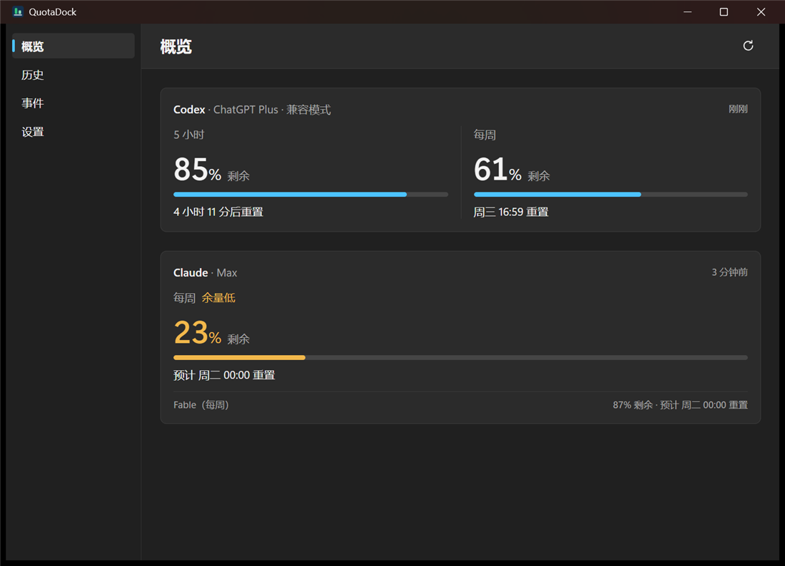
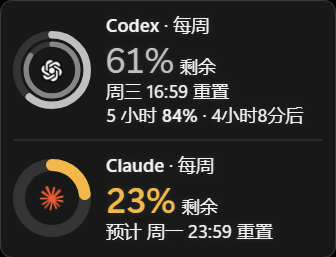
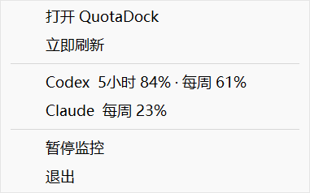
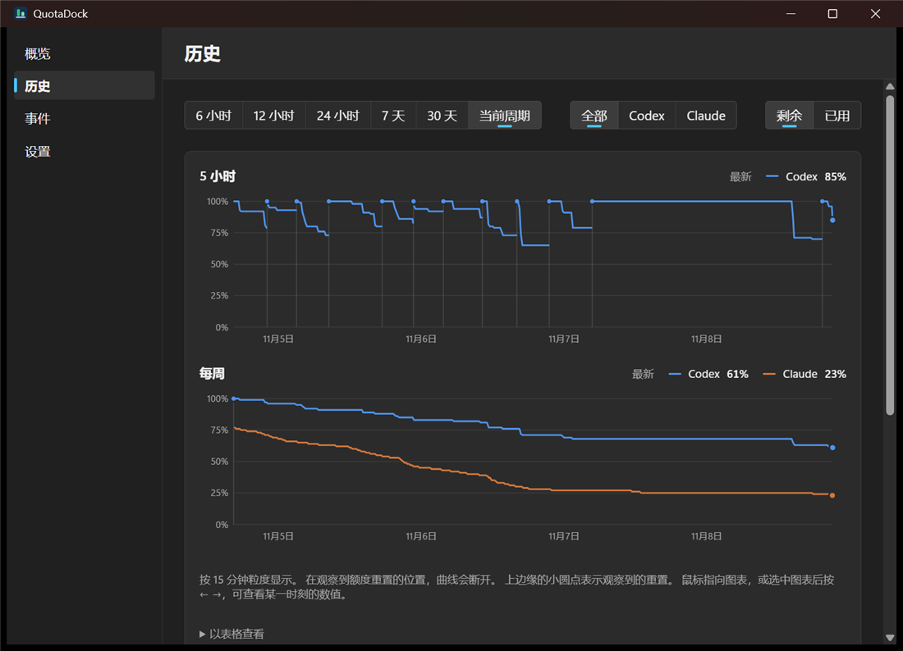
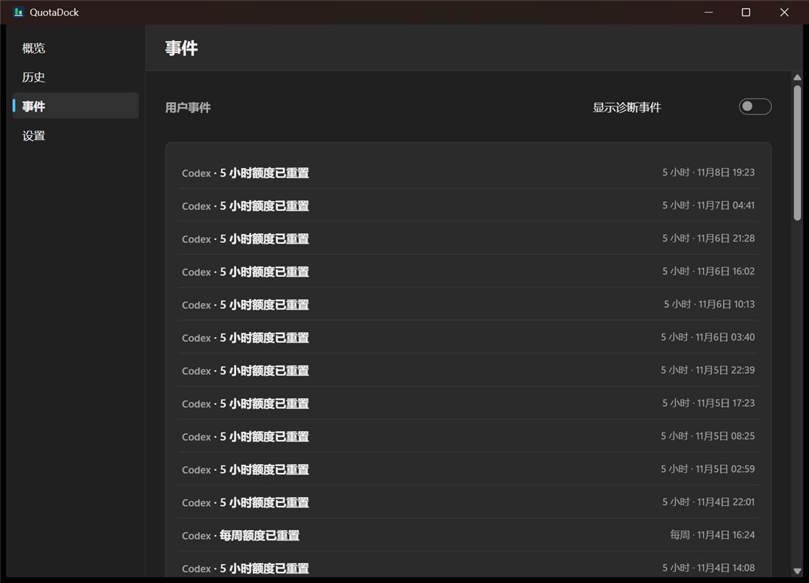
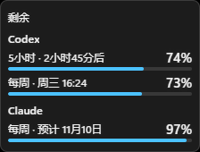
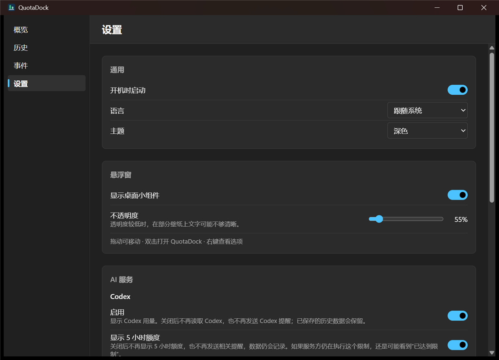
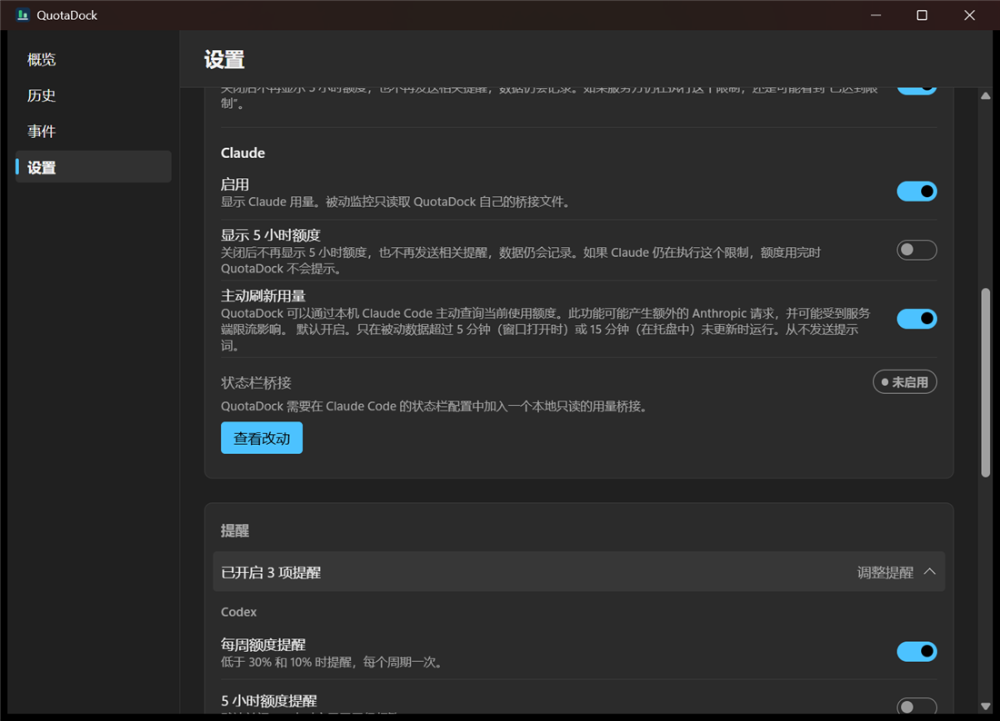
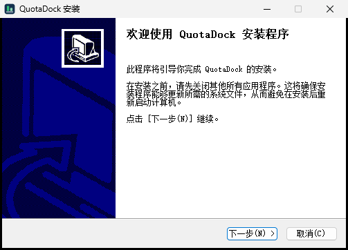
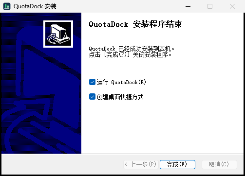

# QuotaDock

**在 Windows 上随时看到 Codex 和 Claude 订阅还剩多少额度。**


QuotaDock 是一个 Windows 小工具。它在主窗口、桌面浮窗、托盘图标和 Windows 通知里显示 **Codex（OpenAI）** 和 **Claude（Anthropic）** 的 **5 小时额度** 和 **每周额度**：还剩多少，什么时候重置。

它 **只读、只在本地运行**。它不登录你的账号，不读取令牌，不上传数据，也不给 AI 发提示词，所以查看用量本身不消耗额度。

[English](#english) · [使用手册（中文）](docs/MANUAL.md) · [PDF 手册](docs/QuotaDock-Manual.zh-CN.pdf)



| 桌面浮窗（圆环样式） | 托盘菜单 |
|---|---|
|  |  |

---

## 目录

- [能做什么](#能做什么)
- [安全和隐私](#安全和隐私)
- [安装](#安装)
- [第一次使用](#第一次使用)
- [颜色和提醒](#颜色和提醒)
- [常见问题](#常见问题)
- [从源码构建](#从源码构建)
- [项目结构](#项目结构)
- [当前状态和已知限制](#当前状态和已知限制)
- [English](#english)

---

## 能做什么

| 功能 | 说明 |
|---|---|
| **概览** | 每个服务的 5 小时和每周额度：剩余百分比、重置时间、套餐名称 |
| **桌面浮窗** | 两种样式：**圆环**（外圈每周、内圈 5 小时，像手机电量）和 **紧凑列表**；可调透明度、置顶、锁定位置 |
| **托盘图标** | 两根柱子，左边 Codex、右边 Claude，柱子越高剩得越多，颜色随余量变化 |
| **Windows 通知** | 额度低于 30%、低于 10%、提前重置、读不到数据时提醒；每一项可以单独开关 |
| **历史** | 记录用量变化，画出曲线，标出每一次重置 |
| **估算** | 按最近的速度推算额度会不会在重置前用完（会明确标注为“估算”） |
| **只用一个服务** | Codex 和 Claude 可以只开一个 |
| **自定义 logo** | 浮窗中间可以换成你自己放进去的图标 |
| **中英文界面** | 设置 → 语言 切换 |

<details>
<summary>更多截图</summary>

| 历史 | 事件 |
|---|---|
|  |  |

| 紧凑样式浮窗 | 托盘图标（放大） |
|---|---|
|  |  |

| 设置：通用 | 设置：提醒 |
|---|---|
|  |  |

</details>

---

## 安全和隐私

| 它不会做 | 说明 |
|---|---|
| 不会登录你的账号 | 你需要自己先登录 Codex 和 Claude Code |
| 不会读取或复制令牌、密码、Cookie | 只通过官方客户端自己的功能读取用量 |
| 不会上传任何数据 | 数据只保存在 `%LOCALAPPDATA%\QuotaDock`，没有遥测 |
| 不会给 AI 发提示词 | 读取用量不消耗额度 |
| 不会偷偷改你的设置 | 改 Claude Code 设置前会先给你看改动，你同意才改，并且可以一键恢复 |

**它是怎么拿到数据的：**

- **Codex：** 启动 Codex 官方客户端自带的本地服务（`codex app-server`），读取账户的额度信息（`account/rateLimits/read`）。
- **Claude：** 默认在本机运行 Claude Code 自带的 `/usage` 命令读取用量，只在数据过期时运行。另外有一个 **可选** 的“状态栏桥接”，Claude Code 每次更新状态栏时把额度数字交给 QuotaDock，**默认不启用**。

详细说明见手册 [第 11 节](docs/MANUAL.md#11-claude-的两种数据来源) 和 [第 12 节](docs/MANUAL.md#12-数据和隐私)。

---

## 安装

### 需要准备

- **Windows 11（64 位）**，不需要管理员权限。
- **Codex**（官方桌面版或命令行，用 ChatGPT 账号登录），和/或 **Claude Code**（用 Pro / Max 等订阅账号登录）。只装其中一个也可以。

### 方式 A：用安装包（推荐）

1. 到本仓库的 **[Releases](https://github.com/Longlong-Li-00/QuotaDock/releases)** 页面下载 `QuotaDock_<版本>_x64-setup.exe`。
   如果 Releases 里还没有安装包，请用下面的 [方式 B](#从源码构建) 自己构建。
2. 双击运行。如果出现蓝色的“Windows 已保护你的电脑”，点 **更多信息 → 仍要运行**。出现这个提示是因为安装包 **还没有代码签名**。
3. 按向导点“下一步”，最后保持勾选 **运行 QuotaDock**，点“完成”。

| 欢迎 | 完成 |
|---|---|
|  |  |

- **安装位置：** `%LOCALAPPDATA%\Programs\QuotaDock`。
- **升级：** 直接运行新版安装包，选 **覆盖安装并保留数据（推荐）**。安装程序会先把数据库备份到数据文件夹的 `backups\` 里。
- **卸载：** 设置 → 应用 → 已安装的应用 → QuotaDock。

### 方式 B：从源码构建

见下面的 [从源码构建](#从源码构建)。

---

## 第一次使用

1. 打开 QuotaDock，看 **概览** 页，能看到额度就说明成功了。
2. 想要桌面浮窗：**设置 → 悬浮窗 → 显示桌面小组件**。
3. 想要开机自动运行：**设置 → 通用 → 开机时启动**。
4. 关掉主窗口后，程序会留在托盘里继续工作。要彻底退出，右键托盘图标 → **退出**。
5. 只用一个服务时，到 **设置 → AI 服务** 把另一个的“启用”关掉。

浮窗操作：按住拖动可以移动（锁定后不能拖）；**双击** 打开主窗口；**右键** 打开菜单（锁定位置、总在最前、圆环 / 紧凑样式、隐藏）。透明度在 **设置 → 悬浮窗** 里调。

---

## 颜色和提醒

浮窗圆环、数字、概览页的进度条和托盘柱子都会按 **剩余额度** 变色：

| 剩余 | 颜色 |
|---|---|
| 高于 50% | 正常 |
| 不高于 50% | 黄色 |
| 不高于 30% | 橙色 |
| 不高于 10% | 红色 |
| 0%（已用完） | 整圈红色 |

**Windows 通知** 在额度降到 **30%** 和 **10%** 以下时各提醒一次，每个周期一次。每一项都能在 **设置 → 提醒** 里单独开关。详见手册 [第 10 节](docs/MANUAL.md#10-提醒)。

---

## 常见问题

**概览页显示“未找到 Codex / Claude Code”或“请先登录”**
先确认它们已经安装、能正常使用，并且已经登录。QuotaDock 不会替你安装或登录。

**托盘里看不到图标**
Windows 11 把它收进了任务栏右下角的“^”里。点开“^”就能看到，也可以把图标拖到任务栏上。

**Claude 显示“检测到 API 计费”**
你的 Claude Code 用的是 API Key 计费，没有订阅额度可以显示。

**Claude 的数字更新得比 Codex 慢**
这是正常的。Claude 的用量只在数据过期时才主动刷新一次（主窗口打开时 5 分钟，在托盘时 15 分钟）。

**提示“Codex 版本尚未验证”**
你的 Codex 比 QuotaDock 测试过的最低版本还旧，升级 Codex 即可。（提示“兼容模式”说明 Codex 比测试过的更新，正常，不用处理。）

**Claude 提示“需要验证”**
Claude Code 更新后改了输出格式，QuotaDock 不认识。这时它会停用主动刷新，不会显示错误的数字。

**换浮窗 logo 没有生效**
图片必须是 PNG 或 SVG，并且不超过 256 KB。超过的文件会被忽略，也不会有提示。见手册 [8.5](docs/MANUAL.md#85-换成自己的-logo可选)。

**遇到别的问题**
设置 → 高级 → **导出诊断信息**，把生成的文件（不含对话内容、令牌和密码）连同问题描述一起发给作者。

更多问题见手册 [第 14 节](docs/MANUAL.md#14-常见问题和排错)。

---

## 从源码构建

**需要：** [Rust](https://rustup.rs/)（MSVC 工具链，含 Visual Studio C++ 生成工具）、[Node.js](https://nodejs.org/) 23.6 或更新版本、Git。在 PowerShell 里运行：

```powershell
git clone https://github.com/Longlong-Li-00/QuotaDock.git
cd QuotaDock

# 界面部分的依赖
cd ui; npm install; cd ..

# 打包工具（只需要一次）
cargo install tauri-cli --version 2.12.4 --locked --root target\tools

# 构建安装包
powershell -ExecutionPolicy Bypass -File scripts\package-windows.ps1
```

安装包会生成在 `target\release\bundle\nsis\` 里。第一次打包时会自动下载 NSIS，所以需要联网；如果下载超时，`scripts\package-windows.ps1` 开头的注释写了手动处理的办法。

**运行测试：**

```powershell
cargo test --workspace
cargo clippy --workspace --all-targets -- -D warnings
cd ui
node node_modules/typescript/bin/tsc --noEmit -p .
node --test "src/**/*.test.ts"
```

---

## 项目结构

| 目录 | 内容 |
|---|---|
| `crates/quotadock-core` | Rust 核心：Codex 和 Claude 数据读取、轮询、SQLite 存储、重置检测、提醒规则、托盘图标绘制 |
| `src-tauri` | Tauri 2 桌面程序：窗口、浮窗、托盘、通知、开机自启，以及 NSIS 安装程序脚本（`windows/`） |
| `ui` | React + TypeScript 界面：主窗口和浮窗 |
| `scripts` | 打包脚本 `package-windows.ps1` 和开发辅助脚本 |
| `src`, `tests` | 早期 TypeScript 参考实现及其测试（Phase 1） |
| `docs` | 使用手册、PDF 和截图 |
| `*_FINDINGS.md` | 每个开发阶段的验收和测试记录 |
| `POST_V1_BACKLOG.md` | 待办和已知问题清单 |

---

## 当前状态和已知限制

- **版本：1.1.0-rc.2（候选版本）。** 作者每天在自己的电脑上使用：1.1.0-rc.1 连续运行了 7.5 天，没有崩溃。
- **安装包没有代码签名**，所以 Windows 会提示“未知发布者”。
- **只支持 Windows 11（64 位）。**
- Codex 和 Claude Code 都没有公开的查额度接口。如果它们大改，QuotaDock 可能需要更新。
- 带“预计”“估算”字样的内容是 QuotaDock 自己推算的，不是服务方给出的数字。
- 手册目前只有中文版。程序界面有中文和英文。
- 本项目和 OpenAI、Anthropic 没有关系。Codex、Claude 是各自公司的商标。
- 仓库里 **还没有开源许可证**。

---

## English

**QuotaDock** is a small Windows 11 app that shows how much of your **Codex** (OpenAI) and **Claude** (Anthropic) subscription quota is left, in both the 5-hour and the weekly window, and when each resets. It shows this in a main window, a desktop widget, a tray icon and Windows notifications.

**Read-only and local.** It never signs in for you, never reads tokens, passwords or cookies, never uploads anything (no telemetry), and never sends a prompt to a model, so checking usage costs no quota. Data stays in `%LOCALAPPDATA%\QuotaDock`.

**How it reads usage**
- **Codex:** through the official client's local `codex app-server` (`account/rateLimits/read`).
- **Claude:** by running Claude Code's own `/usage` command locally, only when the data is stale. There is also an optional status-line bridge, which is off by default and only enabled after you review the change to `~/.claude/settings.json`.

**Features:** ring or compact desktop widget, a tray icon with two bars, colours that change with the quota left (≤50 % yellow, ≤30 % amber, ≤10 % red, 0 % full red ring), notifications at 30 % and 10 %, history charts and reset events, and an English or Chinese UI.

**Install:** download `QuotaDock_<version>_x64-setup.exe` from [Releases](https://github.com/Longlong-Li-00/QuotaDock/releases) if one is published. Otherwise build it yourself with Rust (MSVC), Node.js 23.6+ and:

```powershell
cd ui; npm install; cd ..
cargo install tauri-cli --version 2.12.4 --locked --root target\tools
powershell -ExecutionPolicy Bypass -File scripts\package-windows.ps1
```

The installer is not code-signed yet, so SmartScreen will warn: choose *More info → Run anyway*. You need Codex and/or Claude Code installed and signed in (Claude with a subscription, not API billing).

**Status:** 1.1.0-rc.2, a release candidate. Windows 11 x64 only. The full manual ([docs/MANUAL.md](docs/MANUAL.md)) is in Chinese. There is no licence yet. This project is not affiliated with OpenAI or Anthropic.
