# QuotaDock 使用手册

适用版本：**1.1.0-rc.2**　系统：**Windows 11**　语言：中文（软件本身也有英文界面，在 设置 → 语言 里切换）

> 本手册里的截图都是在 Windows 11 上用真实运行的 QuotaDock 拍摄的（深色主题），图中的数字是作者自己账号的用量。
> 安装向导里的用户名已经遮盖，写成了 `<用户名>`。

---

## 目录

1. [QuotaDock 是什么](#1-quotadock-是什么)
2. [5 分钟快速上手](#2-5-分钟快速上手)
3. [使用前要准备什么](#3-使用前要准备什么)
4. [安装](#4-安装)
5. [第一次启动](#5-第一次启动)
6. [主窗口：概览、历史、事件](#6-主窗口概览历史事件)
7. [设置页逐项说明](#7-设置页逐项说明)
8. [桌面小组件（浮窗）](#8-桌面小组件浮窗)
9. [系统托盘图标和菜单](#9-系统托盘图标和菜单)
10. [提醒](#10-提醒)
11. [Claude 的两种数据来源](#11-claude-的两种数据来源)
12. [数据和隐私](#12-数据和隐私)
13. [升级和卸载](#13-升级和卸载)
14. [常见问题和排错](#14-常见问题和排错)
15. [已知限制](#15-已知限制)

---

## 1. QuotaDock 是什么

QuotaDock 是一个运行在 Windows 上的小工具，让你随时看到自己的 **Codex**（OpenAI）和 **Claude**（Anthropic）订阅还剩多少额度，什么时候重置。

它可以：

- 在主窗口里显示 **5 小时额度** 和 **每周额度** 还剩多少，以及什么时候重置。
- 在桌面上放一个小浮窗，不用打开主窗口也能看到。
- 在系统托盘里放一个图标，用两根柱子表示两个服务的余量。
- 额度快用完、读不到数据时弹出 Windows 通知。
- 记录历史，画出额度变化曲线，记下每一次额度重置。

它的原则是 **只读、本地**：

| 它不会做 | 说明 |
|---|---|
| 不会登录你的账号 | 需要你自己先登录 Codex 和 Claude Code |
| 不会读取或复制你的登录令牌、密码、Cookie | 只通过官方客户端自己的命令读用量 |
| 不会上传任何数据 | 用量记录只保存在你这台电脑上，没有遥测 |
| 不会给 AI 发提示词 | 读取用量不会消耗你的额度 |
| 不会偷偷改你的设置 | 要改 Claude Code 的设置之前，会先让你看清楚改什么，你同意才改 |

---

## 2. 5 分钟快速上手

1. 确认电脑上装了 **Codex** 或 **Claude Code**（两个都装更好，只用一个也行），并且都已经登录。
2. 安装 QuotaDock（见 [第 4 节](#4-安装)）。
3. 安装完成时保持勾选“运行 QuotaDock”，点“完成”。
4. 看 **概览** 页：能看到你的额度，就成功了。
5. 想要桌面小浮窗：**设置 → 悬浮窗 → 显示桌面小组件**。
6. 想要开机自动运行：**设置 → 通用 → 开机时启动**。

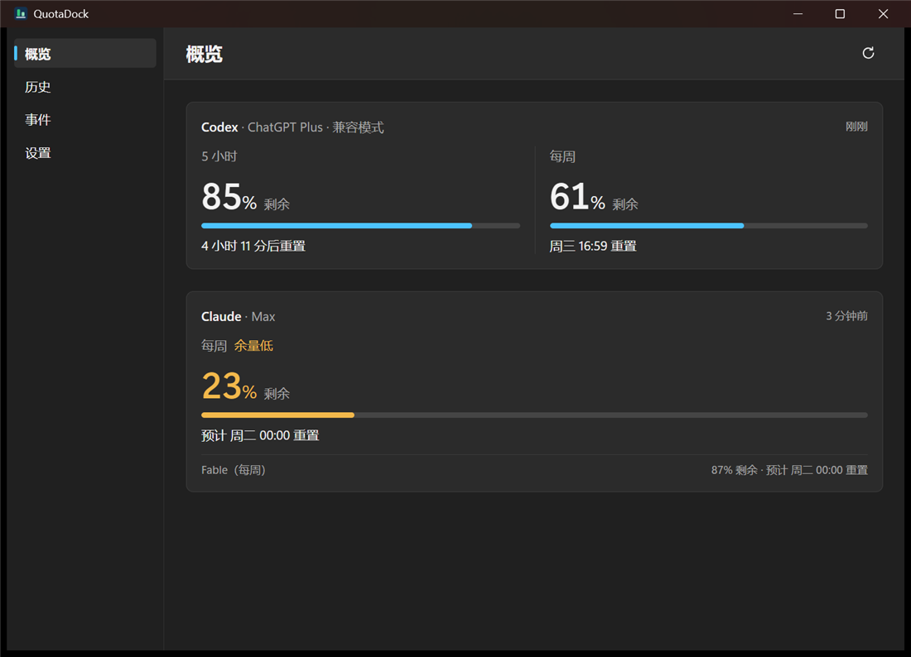

---

## 3. 使用前要准备什么

| 项目 | 要求 |
|---|---|
| 系统 | Windows 11（64 位）。不需要管理员权限，安装在你自己的用户目录里 |
| Codex | 安装官方 **Codex 桌面版** 或 **Codex 命令行（CLI）**，并用 ChatGPT 账号登录。QuotaDock 会自己找到它 |
| Claude | 安装 **Claude Code**（npm 或官方安装程序），并用 **Claude 订阅账号**（Pro / Max 等）登录 |
| 网络 | QuotaDock 自己不联网。Codex、Claude Code 自己读取用量时需要联网，这是它们本身的行为 |

说明：

- **两个服务可以只用一个。** 不用的那个，在 设置 → AI 服务 里把它的“启用”关掉。
- 如果 Claude Code 用的是 **API Key 计费**（不是订阅），Claude 没有订阅额度可看，QuotaDock 会显示“检测到 API 计费”。
- QuotaDock 不会替你安装或登录 Codex 和 Claude Code。没装、没登录时，它会在概览页提示你怎么做（见 [第 14 节](#14-常见问题和排错)）。

---

## 4. 安装

有两种方式。**能拿到安装包就用方式 A，最简单。**

### 方式 A：用安装包（推荐）

1. 打开本仓库的 **Releases** 页面，下载 `QuotaDock_1.1.0-rc.2_x64-setup.exe`。
   （如果 Releases 里还没有安装包，说明作者还没有发布，请用方式 B 自己构建。）
2. 双击运行。
3. 如果 Windows 弹出蓝色的“Windows 已保护你的电脑”（SmartScreen）：这是因为 **这个安装包目前没有代码签名证书**，Windows 不认识发布者。点 **更多信息 → 仍要运行**。你也可以先用下面的命令查看文件的 SHA-256，和 Releases 页面写的值对一下：

   ```powershell
   Get-FileHash .\QuotaDock_1.1.0-rc.2_x64-setup.exe -Algorithm SHA256
   ```

4. 按向导走：

**第 1 步：欢迎页。** 点“下一步”。

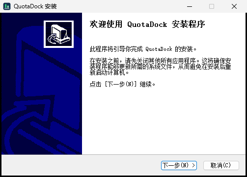

**第 2 步：选择安装位置。** 默认装在你用户目录下的 `AppData\Local\Programs\QuotaDock`，不需要管理员权限，一般不用改。点“下一步”。

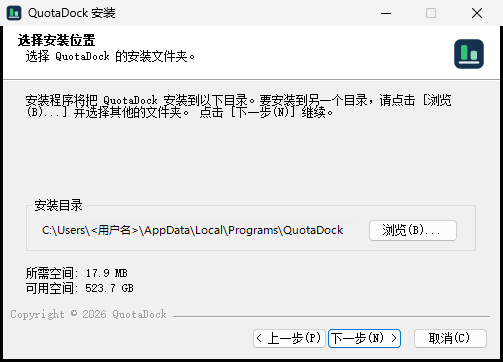

**第 3 步：安装中。** 等进度条走完（几秒钟）。

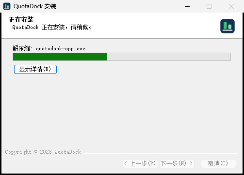

**第 4 步：完成。** 两个选项都默认勾选：

- **运行 QuotaDock**：点“完成”后马上启动。
- **创建桌面快捷方式**：在桌面放一个图标。

点“完成”。

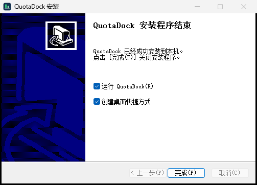

安装完成后，开始菜单里也会有 QuotaDock。

**如果电脑上已经装过旧版本：** 向导会多出一页“已安装”，默认选中 **“覆盖安装并保留数据（推荐）”**。直接点“下一步”就行，你的历史记录和设置都会保留，并且安装前会自动备份一份数据库（见 [第 13 节](#13-升级和卸载)）。

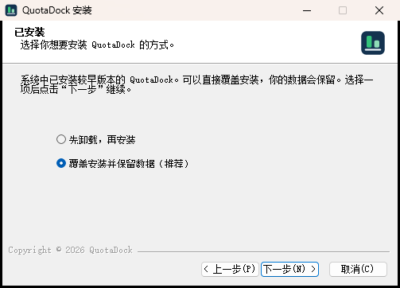

### 方式 B：自己从源码构建

适合会用命令行的人。以下步骤都在 PowerShell 里做。

**需要先装好：**

- [Rust](https://www.rustup.rs/)（选 MSVC 工具链，同时需要 Visual Studio 的 “C++ 生成工具”）
- [Node.js](https://nodejs.org/) 23.6 或更新版本
- Git

**步骤：**

```powershell
# 1. 下载代码
git clone https://github.com/Longlong-Li-00/QuotaDock.git
cd QuotaDock

# 2. 安装界面部分的依赖
cd ui
npm install
cd ..

# 3. 安装打包工具（只需要做一次，需要联网）
cargo install tauri-cli --version 2.12.4 --locked --root target\tools

# 4. 构建安装包
powershell -ExecutionPolicy Bypass -File scripts\package-windows.ps1
```

构建完成后，安装包在：

```
target\release\bundle\nsis\QuotaDock_1.1.0-rc.2_x64-setup.exe
```

双击它，然后按方式 A 的第 4 步安装。

> 注意：
> - 第一次打包时，打包工具会自动下载 NSIS（制作安装程序的工具），所以需要联网。如果下载超时，`scripts\package-windows.ps1` 文件开头的注释里写了手动下载的办法。
> - 完整构建需要几分钟，并占用几个 GB 的磁盘。
> - 作者在自己的电脑上按这套流程构建并验证过；没有在全新的电脑上从头跑过一遍。

---

## 5. 第一次启动

- 启动后会打开 **主窗口**，默认显示 **概览** 页。
- **桌面小组件默认是关闭的**，需要的话到 设置 里打开。
- **开机自启默认也是关闭的**，需要的话到 设置 里打开。
- QuotaDock 同时会在系统托盘里放一个图标。**Windows 11 常常把新图标收在任务栏右下角的“^”里**，点开“^”就能看到。想让它一直显示在任务栏上，把图标从“^”里拖到任务栏即可（或者：设置 → 个性化 → 任务栏 → 其他系统托盘图标）。
- **关闭主窗口不会退出程序**，它会继续在托盘里监控。第一次关闭时会提示“QuotaDock 仍在运行”，可以勾“不再提示”。
- 要真正退出：右键托盘图标 → **退出**，或者 设置 → 高级 → **退出 QuotaDock**。

QuotaDock 同一时间只会运行一个。再次双击它的图标，只会把已经在运行的那个窗口调出来。

---

## 6. 主窗口：概览、历史、事件

左边是四个页面：**概览、历史、事件、设置**。

### 6.1 概览


每个服务一张卡片：

- **Codex 卡片**（上图）
  - 标题行：服务名、你的套餐（如 ChatGPT Plus）。“兼容模式”表示你的 Codex 比 QuotaDock 测试过的版本更新，这是正常的，只要数据格式没变就照常读取。
  - 左边 **5 小时**，右边 **每周**：大数字是 **剩余** 的百分比，下面的进度条是余量，再下面是 **什么时候重置**。
  - 右上角的“刚刚 / 3 分钟前”是这份数据多久之前更新的。
- **Claude 卡片**
  - 同样显示余量和重置时间。
  - 带“预计”两个字的时间（如“预计 周一 23:59 重置”）说明这个时间是根据已知规律推算的，不是服务方明确给出的。
  - 卡片下面还会列出 Claude 的其他单独额度（如图里的 Fable）。
  - 如果按目前的速度会在重置前用完，卡片里会用橙色字提示“按当前速度约 周日 用完，早于重置（估算）”。**这是 QuotaDock 的估算，不是服务方提供的数字。**
- **颜色含义（像手机电量）：** 余量高于 50% 是正常颜色；不高于 50% 变 **黄色**，不高于 30% 变 **橙色**（“余量低”），不高于 10% 变 **红色**（“余量极低”）。已经用完（0%）会显示“已达到限制”，浮窗里的整圈都变红。
- **5 小时额度显示“空闲 · 首次使用后开始计时”：** 表示这个 5 小时窗口还没开始，你下一次使用时才开始计时。
- **手动刷新：** 点右上角的刷新按钮。刚刷新过会显示“刚刚已刷新”，短时间内不会重复请求。

**自动刷新的频率是固定的**：主窗口打开时每分钟一次，缩在托盘里时每 5 分钟一次。

### 6.2 历史

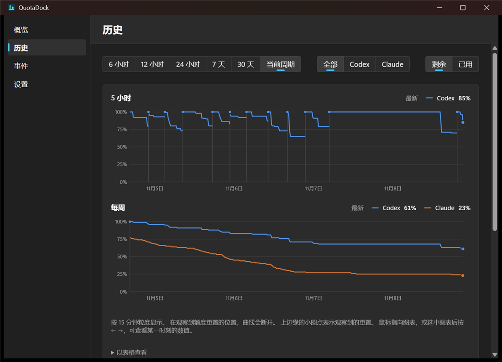

- 顶部三组按钮：
  - **时间范围**：6 小时 / 12 小时 / 24 小时 / 7 天 / 30 天 / 当前周期。
  - **服务**：全部 / Codex / Claude。
  - **显示方式**：剩余 / 已用。
- 上面一张图是 **5 小时额度**，下面一张是 **每周额度**。
- 曲线在 **观察到额度重置的地方会断开**，图上边缘的小圆点和竖线就是一次重置。
- 把鼠标放到图上，或者点一下图再按键盘的 **← →**，可以看某个时刻的具体数值。
- 图下面的“以表格查看”可以看原始数据。

### 6.3 事件

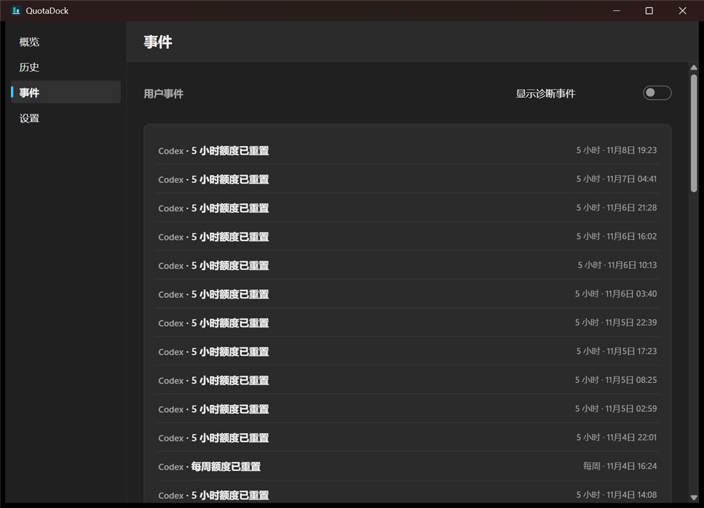

这里按时间倒序记录 QuotaDock **观察到的额度变化**，例如“5 小时额度已重置”“每周额度已重置”。

- 默认只显示用户事件。打开右上角的 **显示诊断事件** 会多显示一些技术性的事件（例如重置时间的调整）。
- 点开一条事件，可以看到变化前后的数值、依据和可信程度，还可以“复制技术详情”，用于反馈问题。

---

## 7. 设置页逐项说明

设置页从上到下分为：通用、悬浮窗、AI 服务、提醒、高级。

### 7.1 通用

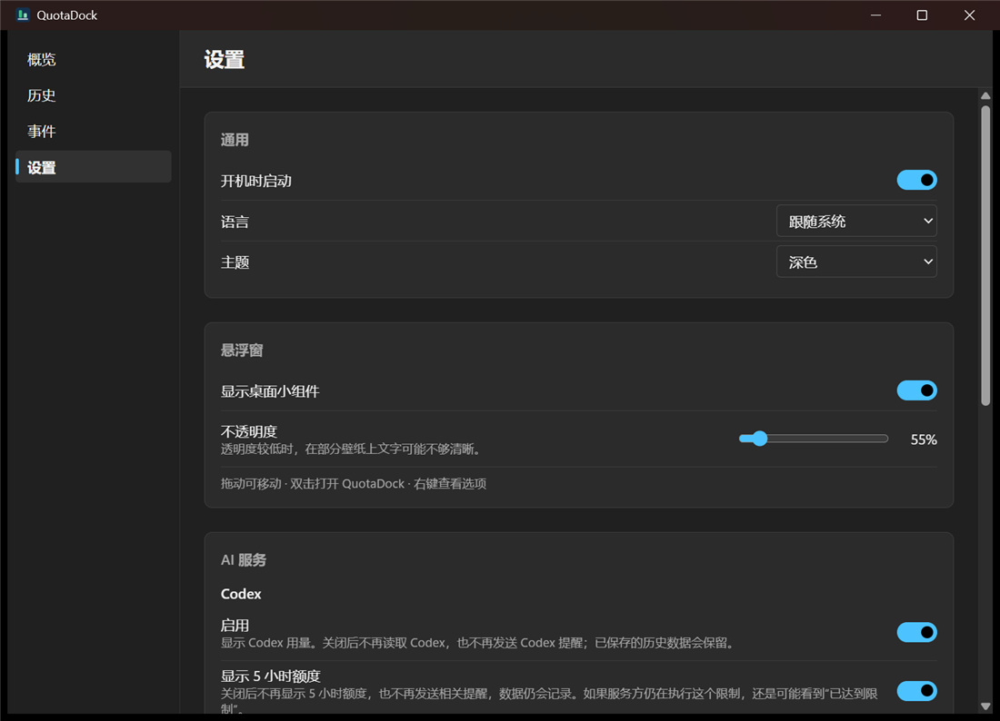

| 项目 | 说明 |
|---|---|
| 开机时启动 | 开启后，登录 Windows 时自动在后台启动（只在托盘里，不弹窗口） |
| 语言 | 跟随系统 / 中文 / English |
| 主题 | 跟随系统 / 浅色 / 深色 |

### 7.2 悬浮窗

| 项目 | 说明 |
|---|---|
| 显示桌面小组件 | 打开或关闭桌面小浮窗（详见 [第 8 节](#8-桌面小组件浮窗)） |
| 不透明度 | 浮窗的透明程度。调得太透明时，在某些壁纸上文字可能看不清 |

其他浮窗选项（锁定位置、总在最前、详细 / 紧凑）在 **浮窗上点右键** 的菜单里。

### 7.3 AI 服务

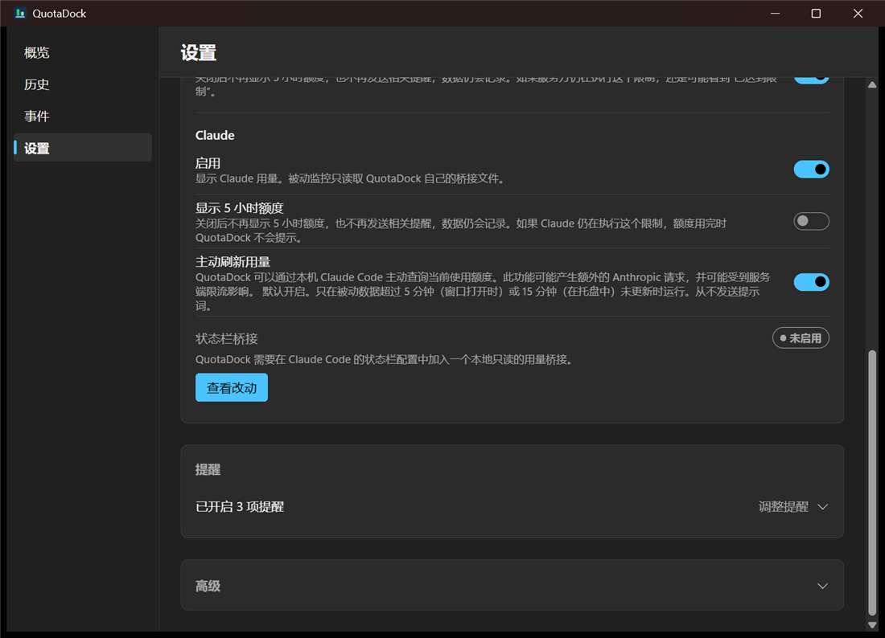

分 Codex 和 Claude 两块：

| 项目 | 说明 |
|---|---|
| 启用 | 开 / 关这个服务。关闭后不再读取它，也不再发它的提醒；已经保存的历史会保留 |
| 显示 5 小时额度 | 你的套餐没有 5 小时限制，或者你不关心它时可以关掉。关闭后各处都不再显示 5 小时额度，也不发相关提醒，但数据仍然记录。注意：服务方如果仍在执行这个限制，你照样可能被限制，只是 QuotaDock 不会提示 |
| 主动刷新用量（仅 Claude） | 见 [第 11 节](#11-claude-的两种数据来源) |
| 状态栏桥接（仅 Claude） | 见 [第 11 节](#11-claude-的两种数据来源) |

### 7.4 提醒

见 [第 10 节](#10-提醒)。

### 7.5 高级

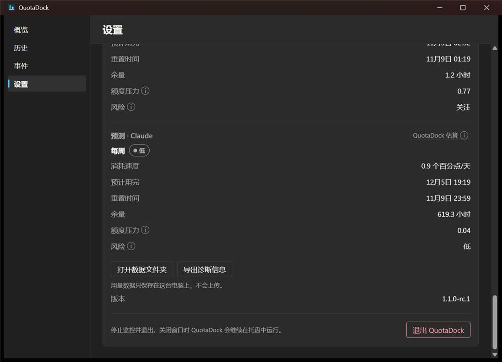

- **预测**：QuotaDock 根据近期用量做出的估算（页面上标着“QuotaDock 估算”），包含消耗速度、预计用完的时间、重置时间、余量、额度压力、风险等级。数据太少时会显示“历史数据不足，暂无法预测”。
- **打开数据文件夹**：打开保存数据的文件夹。
- **导出诊断信息**：导出一份不含个人信息的诊断文件，用于反馈问题。
- **版本**：当前版本号。
- **退出 QuotaDock**：停止监控并完全退出。

---

## 8. 桌面小组件（浮窗）

一个放在桌面上的小窗口，随时看到余量。它只显示 QuotaDock 已经有的数据，自己不会去请求任何服务。

### 8.1 打开

**设置 → 悬浮窗 → 显示桌面小组件**。

### 8.2 两种样式

**详细模式（圆环）**：每个服务一个圆环。

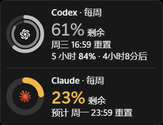

- **外圈** 是 **每周额度**，旁边的大数字就是每周剩余百分比。
- **内圈（较细）** 是 **5 小时额度**，它也有自己的一行文字，例如“5 小时 84% · 4 小时 8 分后”。
- 如果你把某个服务的 5 小时额度隐藏了，它就只剩一个 **更粗的单圈**（上图的 Claude）。
- 圆环和数字的颜色随余量变化：不高于 50% **黄色**，不高于 30% **橙色**，不高于 10% **红色**；用完（0%）时整圈都是红色，一眼就能看出。内圈（5 小时）和外圈（每周）用同一套颜色。
- 圆环中间的图标：默认是内置的简单图标（Codex 是代码括号，Claude 是对话气泡）；也可以换成你自己的 logo，见下面 8.5。

**紧凑模式**：只有进度条和百分比，更省地方。

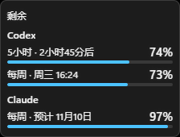

### 8.3 操作

| 操作 | 效果 |
|---|---|
| 拖动 | 移动位置（锁定后不能拖） |
| **双击** | 打开主窗口 |
| **右键** | 打开选项菜单 |

### 8.4 右键菜单

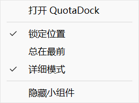

| 菜单项 | 说明 |
|---|---|
| 打开 QuotaDock | 打开主窗口 |
| 锁定位置 | 勾选后浮窗不能被拖动 |
| 总在最前 | 勾选后浮窗始终在其他窗口上面；不勾选时，会被其他窗口盖住 |
| 详细模式 | 勾选是圆环样式，不勾选是紧凑样式 |
| 隐藏小组件 | 关闭浮窗（程序和监控继续运行，要再显示就到 设置 里打开） |

浮窗的位置会被记住，重启后还在原处。

### 8.5 换成自己的 logo（可选）

QuotaDock **不自带** OpenAI、Anthropic 的商标图案，圆环中间默认是简单的通用图标。如果你想用官方 logo，请自己从官方的品牌资源页下载，然后放到固定位置：

1. 打开文件夹 `%LOCALAPPDATA%\QuotaDock`（在资源管理器地址栏输入这个路径回车）。
2. 在里面新建文件夹 **`icons`**。
3. 把图片放进去，文件名要这样（全小写）：
   - Codex：`codex.png` 或 `codex.svg`
   - Claude：`claude.png` 或 `claude.svg`
4. 稍等片刻，浮窗会自动换成你的图标；如果没换，退出 QuotaDock 再打开。

**要求：**

- 只支持 **PNG 和 SVG**，每个文件 **不能超过 256 KB**。太大、格式不对、文件损坏时会 **不报错、直接继续用内置图标**。
- 圆环中间的位置只有约 20×20 像素，PNG 用 **正方形、透明背景、64–128 像素** 就够了。
- 浮窗底色是深色，所以请用 **白色或浅色版本** 的 logo，黑色的看不清。
- 只有详细模式（圆环）会显示这些图标。
- 想换回内置图标：把文件删掉或改名。

**图片太大怎么办？** 官方下载的图片常常有几百 KB。可以用下面的 PowerShell 命令缩成 128×128（把前两个路径换成你的文件）：

```powershell
Add-Type -AssemblyName System.Drawing
$in  = "$env:USERPROFILE\Downloads\codex-logo.png"            # 你下载的大图
$out = "$env:LOCALAPPDATA\QuotaDock\icons\codex.png"          # 放到 icons 文件夹，文件名要对
New-Item -ItemType Directory -Force (Split-Path $out) | Out-Null
$img = [Drawing.Image]::FromFile($in)
$bmp = New-Object Drawing.Bitmap 128, 128, ([Drawing.Imaging.PixelFormat]::Format32bppArgb)
$g = [Drawing.Graphics]::FromImage($bmp)
$g.InterpolationMode = "HighQualityBicubic"; $g.SmoothingMode = "HighQuality"; $g.PixelOffsetMode = "HighQuality"
$g.Clear([Drawing.Color]::Transparent); $g.DrawImage($img, 0, 0, 128, 128)
$g.Dispose(); $img.Dispose()
$bmp.Save($out, [Drawing.Imaging.ImageFormat]::Png); $bmp.Dispose()
"saved $out ($((Get-Item $out).Length) bytes)"
```

> 商标提醒：官方 logo 属于它们各自的公司。自己电脑上自己用没有问题；如果你要把 QuotaDock 发给别人，请不要把这些图片一起打包。

---

## 9. 系统托盘图标和菜单

### 9.1 图标上的两根柱子


- **左边的柱子是 Codex，右边的柱子是 Claude。**
- 柱子越高，**每周额度剩得越多**。
- 柱子的颜色：灰色是正常；不高于 50% **黄色**，不高于 30% **橙色**，不高于 10% 以及已用完是 **红色**（柱子背后的底槽也会带上同样的颜色）。
- 某个服务被关闭或还没有数据时，对应的位置只有一个空的底槽。
- **暂停监控** 或 **读数据出错** 时，图标会换成专门的暂停 / 错误图标，因为这时候柱子的数字不可信。

### 9.2 右键菜单

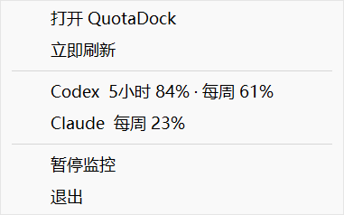

| 菜单项 | 说明 |
|---|---|
| 打开 QuotaDock | 打开主窗口（左键单击图标也行） |
| 立即刷新 | 马上读一次用量 |
| 当前余量（两行文字） | 显示 Codex 和 Claude 的当前数值，只是显示，点不了 |
| 暂停监控 / 恢复监控 | 暂停期间不读取任何用量；重新启动 QuotaDock 后会自动恢复 |
| 退出 | 完全退出 |

把鼠标停在托盘图标上，还会弹出一个提示，显示两个服务的余量和“刚刚更新”。

---

## 10. 提醒

QuotaDock 会通过 Windows 通知提醒你。在 **设置 → 提醒 → 调整提醒** 里逐项开关。

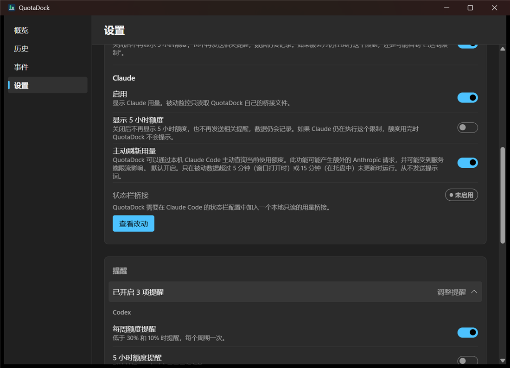

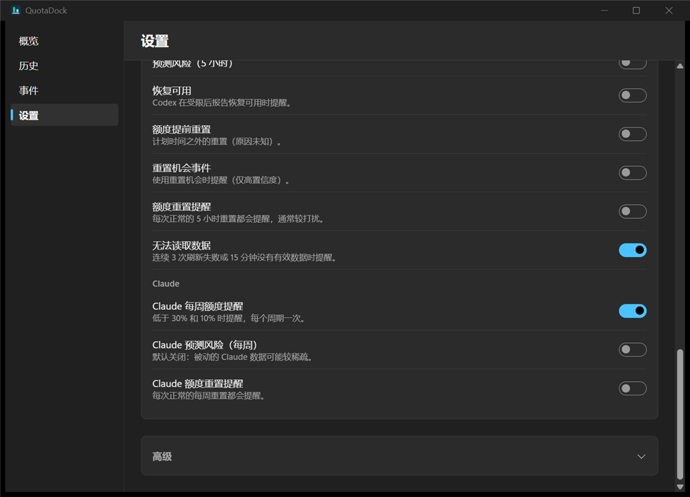

**Codex 的提醒：**

| 提醒 | 什么时候发 | 新安装默认 |
|---|---|---|
| 每周额度提醒 | 每周额度降到 30% 和 10% 以下时，每个周期各提醒一次 | 开 |
| 5 小时额度提醒 | 5 小时额度降到 30% 和 10% 以下时 | 关（5 小时窗口重置得太频繁） |
| 预测风险（每周） | QuotaDock 估算“可能在重置前用完”时，每个周期最多一次 | 开 |
| 预测风险（5 小时） | 同上，针对 5 小时额度 | 关 |
| 恢复可用 | 额度用完被限制后，Codex 报告恢复可用时 | 开 |
| 额度提前重置 | 额度在预定时间之外被重置（原因不明）时 | 开 |
| 重置机会事件 | 使用了“重置机会”时 | 开 |
| 额度重置提醒 | 每一次正常的重置都提醒，比较打扰 | 关 |
| 无法读取数据 | 连续 3 次刷新失败，或 15 分钟没有有效数据时 | 开 |

**Claude 的提醒：**

| 提醒 | 什么时候发 | 新安装默认 |
|---|---|---|
| Claude 每周额度提醒 | 降到 30% 和 10% 以下时 | 开 |
| Claude 5 小时额度提醒 | 同上，针对 5 小时 | 关 |
| Claude 预测风险（每周） | 估算可能提前用完时（Claude 的数据可能比较稀疏，所以默认关） | 关 |
| Claude 额度重置提醒 | 每次正常的每周重置都提醒 | 关 |

说明：

- 默认值以你安装后设置页里实际显示的为准；上表是新安装的初始状态。
- 如果在 Windows 的 设置 → 系统 → 通知 里把 QuotaDock 的通知关了，就收不到提醒。
- 隐藏某个服务的 5 小时额度后，相关的提醒也不会再发。

---

## 11. Claude 的两种数据来源

Claude Code 没有公开的“查额度”接口，所以 QuotaDock 用两种 **都在本机、都只读** 的办法拿到 Claude 的用量，你可以两种都用，也可以只用一种。

### 11.1 主动刷新用量（默认开启，不需要任何设置）

- 在 设置 → AI 服务 → Claude 里，“主动刷新用量”默认是开的。
- 做法：QuotaDock 在需要时，在本机运行一次 Claude Code 自带的 `/usage` 命令来读取用量。**它从不给模型发提示词**（程序里还故意使用一个无效的模型名作为保险，万一发出去了也会失败，不会消耗额度）。
- 触发时机：只有当已有数据超过 5 分钟（主窗口打开时）或 15 分钟（在托盘时）没更新才会运行。
- 前提：电脑上装了 Claude Code，并用订阅账号登录。
- 不想要的话，把这个开关关掉就行。

### 11.2 状态栏桥接（可选，默认不启用）

- 原理：Claude Code 有一个“状态栏”功能，每次回复后会调用一个小程序来生成状态栏文字。QuotaDock 附带一个只读的小程序（`quotadock-claude-bridge.exe`），挂在这个位置上，**每次 Claude Code 更新状态栏时，就把额度数字交给 QuotaDock**。
- 它只保存：5 小时和每周的额度字段、Claude Code 版本、模型名称。**不保存提示词、路径和账号信息。**
- 启用它需要修改 Claude Code 的设置文件（`~/.claude/settings.json`），所以 **不会自动启用**。步骤：

1. 设置 → AI 服务 → Claude → 状态栏桥接 → 点 **查看改动**。
2. 弹出的对话框会清楚列出：要改哪个文件、现在的 statusLine 是什么、改成什么、备份存在哪里。**仔细看一遍。**

   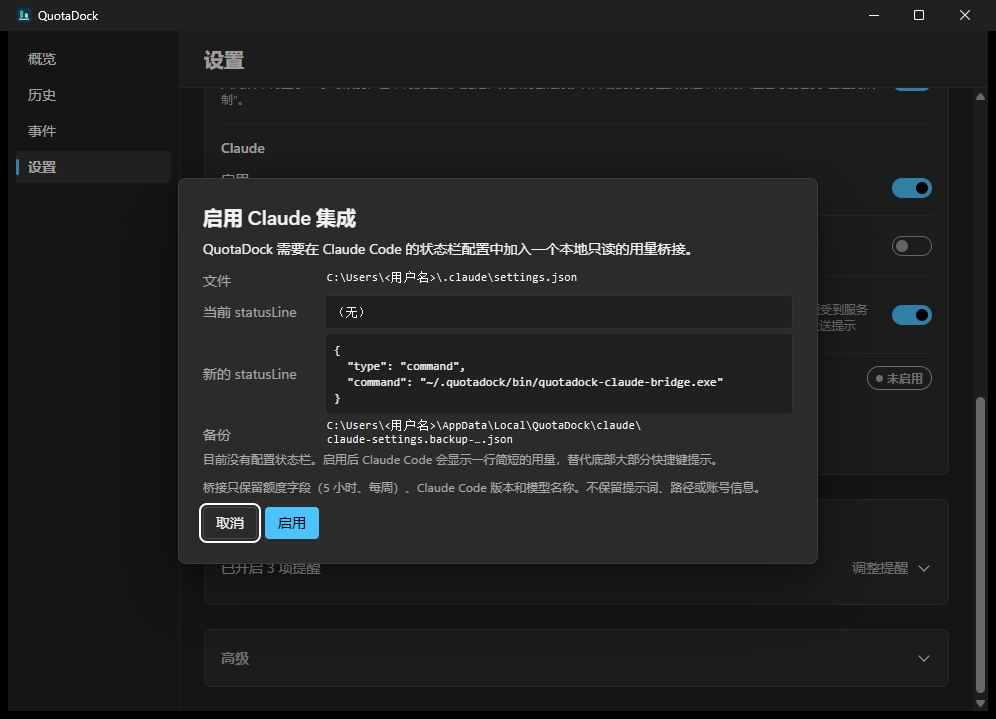

3. 没问题就点 **启用**；不想改点 **取消**。
4. 如果你本来已经有自己的状态栏，**会保留**：桥接会先运行你原来的状态栏，把它的输出显示出来。
5. 修改之前，QuotaDock 会先把原来的设置文件备份一份（在数据文件夹的 `claude` 子文件夹里）。

**怎么停用：** 同一个位置点 **停用并恢复**，会把 Claude Code 的设置恢复成原来的样子。如果你在启用之后自己又改过这个设置文件，QuotaDock 会 **保持原样不动**，不会覆盖你的修改，并告诉你。

> 提示：关闭 Claude 的“启用”开关时，如果桥接还在，会先问你要不要“关闭并恢复”。卸载 QuotaDock 时如果桥接还在，卸载程序也会提醒你（见 [第 13 节](#13-升级和卸载)）。

---

## 12. 数据和隐私

**保存位置：** `%LOCALAPPDATA%\QuotaDock`（可以在 设置 → 高级 → **打开数据文件夹** 直接打开）。

| 内容 | 说明 |
|---|---|
| `quotadock.sqlite3`（以及同名的 `-wal`、`-shm`） | 用量历史数据库 |
| `backups\` | 升级安装时自动做的数据库备份，每个版本一份 |
| `claude\` | Claude 桥接用的数据；启用桥接前对设置文件的备份 |
| `exports\` | “导出诊断信息”生成的文件 |
| `logs\` | 本地运行日志（只有技术性的记录，不含对话内容） |

**隐私说明：**

- 所有数据只保存在本机，**QuotaDock 不会上传任何东西，没有遥测。**
- 只保存额度的百分比、重置时间、套餐名称等“用量元数据”，不读取、不保存你和 AI 的对话。
- 不读取或复制登录令牌、密码、Cookie。
- 如果你要把 QuotaDock 的数据库、日志发给别人看，请先检查，因为里面有你的用量记录。

---

## 13. 升级和卸载

### 13.1 升级

直接运行新版本的安装包，选择 **“覆盖安装并保留数据”**。

- 你的历史数据、设置、浮窗位置、开机自启设置都会保留。
- 安装前会自动把数据库备份到 `%LOCALAPPDATA%\QuotaDock\backups\before-<版本号>\`。
- 如果旧版本正在运行，安装程序会先让它退出。
- 之后如果同一个版本重复安装，不会覆盖已有的那份备份。

### 13.2 卸载

有两种方式，效果一样：

- **方式一**：Windows 设置 → 应用 → 已安装的应用 → QuotaDock → 卸载。
- **方式二**：再次运行安装包，在“已安装”页面选 **卸载 QuotaDock**。

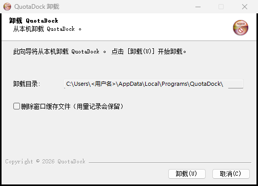

- 卸载页面有一个选项 **“删除窗口缓存文件（用量记录会保留）”**，只清理窗口缓存。
- **默认保留你的用量记录**（`%LOCALAPPDATA%\QuotaDock`）。想彻底删除，卸载后手动删掉这个文件夹。
- 卸载会自动清除开机自启项。

**如果你启用过 Claude 状态栏桥接**，卸载时会看到这个提示：

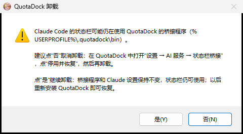

- 推荐点 **“否”（取消卸载）**，先在 QuotaDock 里 设置 → AI 服务 → 状态栏桥接 → **停用并恢复**，然后再卸载。
- 点“是”也可以继续卸载：桥接程序和 Claude Code 的设置会保持不变，状态栏照常可用；以后重新安装 QuotaDock 就能恢复管理。卸载程序不会删掉桥接程序后留下一个指向不存在文件的状态栏设置。

---

## 14. 常见问题和排错

### 概览页的提示

| 你看到的 | 意思和处理办法 |
|---|---|
| **未找到 Codex** | 没找到 Codex。QuotaDock 通过官方 Codex 桌面版或命令行读取用量。安装 Codex，或者打开一次 Codex 桌面版，QuotaDock 会自动重试 |
| **请先登录 Codex** | 打开 Codex 桌面版，用 ChatGPT 账号登录。QuotaDock 不会替你登录 |
| **Codex 版本尚未验证** | 你的 Codex 比 QuotaDock 测试过的最低版本更旧。升级 Codex |
| **兼容模式** | 你的 Codex 比测试过的版本更新。**正常，不用处理**，只要数据格式没变就照常读取 |
| **正在重新连接…** | 最近几次读取失败。QuotaDock 会逐步拉长间隔重试（最长 15 分钟） |
| **未找到 Claude Code** | 请安装 Claude Code |
| **请先登录 Claude Code** | 运行 Claude Code，用 Claude 订阅账号登录 |
| **检测到 API 计费** | Claude Code 现在用 API Key 计费，没有订阅额度可看 |
| **等待 Claude Code** / **未设置** | 还没拿到 Claude 的数据。确认“主动刷新用量”是开着的，且 Claude Code 已登录；或者启用状态栏桥接 |
| **非实时 / 数据已过时** | 这份数据已经有一阵没更新了，请看右上角的更新时间 |
| **需要验证** | Claude Code 返回了 QuotaDock 不认识的格式（比如 Claude Code 更新后改了输出）。这次运行中已自动停用主动刷新，被动数据（桥接）不受影响 |
| **主动刷新暂时受限** | 服务端限流，主动刷新暂停了一阵，之后会自动恢复 |

### 其他问题

**托盘里看不到 QuotaDock 的图标。**
Windows 11 把它收在任务栏右下角的“^”里了。点开“^”就能看到。想让它一直显示在任务栏上，从“^”里把图标拖出来。

**浮窗不见了。**
可能被其他窗口盖住了（“总在最前”没勾选时会这样）。右键托盘图标 → 打开 QuotaDock，确认 设置 → 悬浮窗 → 显示桌面小组件 是开着的；也可以在浮窗上右键勾选“总在最前”。

**浮窗的字看不清。**
设置 → 悬浮窗 → 把 **不透明度** 调高一些。

**我放了自己的 logo，但浮窗上没变。**
最常见的原因是文件太大（超过 256 KB），程序会悄悄忽略它。把图缩小到 128×128 像素（见 [8.5](#85-换成自己的-logo可选)）。其次检查文件名是不是 `codex.png` / `claude.png`（全小写），放的位置是不是 `%LOCALAPPDATA%\QuotaDock\icons`。

**开机没有自动启动。**
设置 → 通用 → 确认 **开机时启动** 是开着的。也可以在 Windows 任务管理器 → 启动应用 里看 QuotaDock 是否被禁用。

**重复打开提示“已经在运行”或什么也没发生。**
QuotaDock 同时只会运行一个，它已经在托盘里了。右键托盘图标 → 打开 QuotaDock。

**我关掉窗口之后它还在占内存。**
这是设计如此：关闭窗口只是最小化到托盘继续监控。要完全退出，托盘菜单 → 退出。

**想暂时停一下。**
托盘菜单 → 暂停监控。暂停期间不读取任何用量；重新启动 QuotaDock 后会自动恢复，也可以随时点“恢复监控”。

**杀毒软件或 SmartScreen 报警。**
目前安装包 **没有代码签名**，Windows 会提示“未知发布者”。你可以核对 SHA-256，或者自己从源码构建（见方式 B）。代码是公开的，你可以自己检查。

**怎么反馈问题？**
设置 → 高级 → **导出诊断信息**，把生成的文件（在数据文件夹的 `exports` 里）连同问题描述一起发给作者。诊断文件里不含对话内容、令牌和密码。

---

## 15. 已知限制

- **只支持 Windows 11（64 位）**。没有 macOS 和 Linux 版。
- 当前是 **候选版本（1.1.0-rc.2）**，并且 **安装包没有代码签名**。
- Codex 和 Claude Code 都没有公开的“查额度”接口，QuotaDock 的读取方式依赖它们现在的行为。**它们如果大改，QuotaDock 可能需要更新**；这时会提示“版本尚未验证”或“需要验证”，而不是显示错误的数字。
- 带“预计”“估算”字样的内容，是 QuotaDock 自己根据近期用量推算的，**不是服务方提供的数字**。
- Claude 的数据可能比 Codex 稀疏：主动刷新有间隔，状态栏桥接只在 Claude Code 更新状态栏时才有数据。
- 程序界面有中文和英文两种语言；本手册只有中文版。
